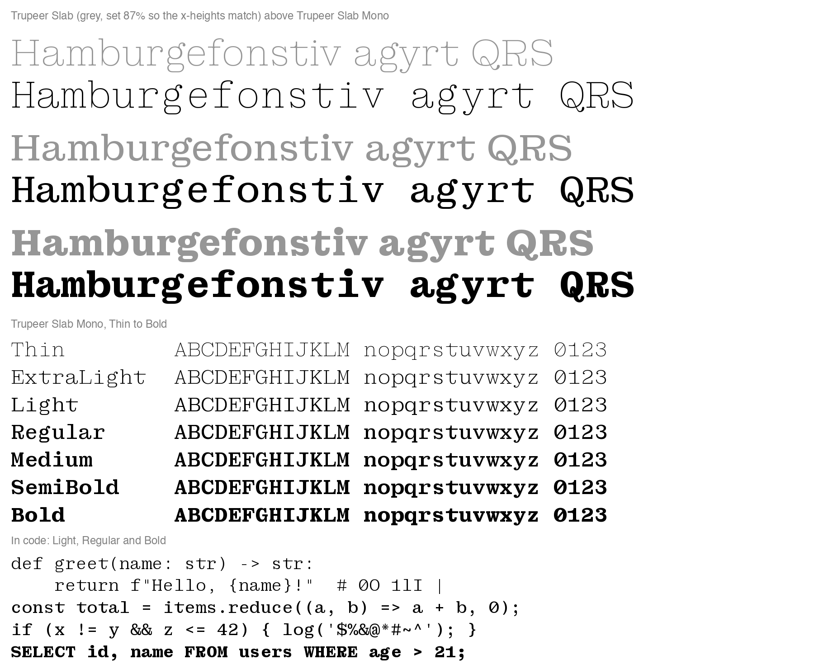

# Trupeer Slab Mono

A monospaced companion to Trupeer Slab. Every character takes the same 600-unit slot.

Seven weights, Thin to Bold, of the 95 basic keyboard characters:

- `fonts/variable/TrupeerSlabMono[wght].ttf`: one file with every weight from 100 to 700
- `fonts/ttf` and `fonts/otf`: Thin, ExtraLight, Light, Regular, Medium, SemiBold and Bold



## How it is made

The glyphs are the original's own drawings (the 16pt optical size in `../sources/TrupeerSlab.glyphs`), not new ones. The family is built from three masters, and the weights between them are interpolated:

- **Thin** from the original's Thin.
- **Regular** from the original's Regular.
- **Bold** from a point 80% of the way from the original's Regular to its Bold (`BOLD_AT` in `tools.py`). The original's Bold is too heavy for the slot. Like Courier Prime Bold and IBM Plex Mono Bold, the mono's Bold is lighter than a proportional Bold.

In every weight:

- **Scale.** The original is set at 87% in the slot (`S` in `tools.py`). At that size its n fits the slot as drawn, which is how typewriter slab monospaces like Courier keep natural proportions: a smaller x-height, not narrower letters. Most lowercase, the figures and most punctuation are used unchanged, only centred.
- **Narrow letters** (i, l, j, r, f, t, I, J, 1) get longer slabs, bars and arms to fill the slot. Only the top serifs of j and J grow, so their hooks keep the original's drawing. These changes are written once for the Regular and made by the same amounts in every weight (`G.like_regular`).
- **Wide letters** (most capitals, m, w, &, @, %, and the Bold's widest lowercase) get narrower counters and serifs. Their stems keep their weight: x is moved towards a heavier drawing before narrowing (`G.condense`). m, w, M and W are kept slightly lighter so they don't read as dark blots.
- **M** keeps upright legs with the V's point raised, as in Courier and IBM Plex Mono.
- **For code:** the original's slashed zero is the default 0, ' and " are straight wedges, / and \ run from below the baseline to above the capitals, and the underscore fills the slot.

Each change is a recipe in `recipes.py`. A glyph without a recipe is used as drawn.

## Building

```bash
pip install -r requirements.txt
python build.py
```

This draws the three masters into `build/` (UFOs and a designspace), then writes the variable font and the seven static weights into `fonts/`.

## Licence

SIL Open Font License 1.1, as for Trupeer Slab (see `../OFL.txt`).
