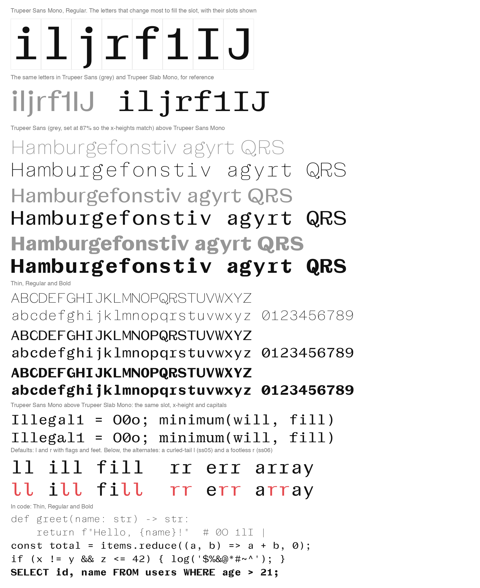

# AA Bridge Sans Mono

A monospaced companion to AA Bridge Sans, and the sans partner of AA Bridge Slab Mono. Every character takes the same 600-unit slot, and both monos share the same scale, x-height and capitals, so they can be set side by side.

Seven weights, Thin to Bold, with the original's character set: 616 of its 618 characters (710 glyphs), covering the Latin languages AA Bridge Sans covers, Vietnamese included. The two left out are the fi and fl ligatures.

- `fonts/variable/AABridgeSansMono[wght].ttf`: one file with every weight from 100 to 700
- `fonts/ttf` and `fonts/otf`: Thin, ExtraLight, Light, Regular, Medium, SemiBold and Bold



## How it is made

The method is AA Bridge Slab Mono's (see `../../slab/mono`). The glyphs are the original's own drawings (the 16pt optical size in `../sources/AABridgeSans.glyphs`), not new ones, built from three masters with the weights between interpolated:

- **Thin** from the original's Thin, **Regular** from its Regular, and **Bold** from a point 80% of the way from its Regular to its Bold (`BOLD_AT` in `tools.py`), as monospace bolds are lighter than proportional ones.

In every weight:

- **Scale.** The original is set at 87% in the slot (`S` in `tools.py`), the same as AA Bridge Slab Mono. Most lowercase, the figures and most punctuation are used as drawn, only centred.
- **Narrow letters get new serifs.** AA Bridge Sans has no slabs to lengthen, so i, j, r, l, I, J and 1 get plain rectangles as thick as the font's own crossbars (the f's bar for lowercase, the T's top for capitals), as in IBM Plex Mono and JetBrains Mono. Their ends sit the same distance from the stem's centre in every weight (`FLAG`, `FOOT` and `CAPFOOT` in `recipes.py`):
  - i: a flag at the x-height and a foot; j: a flag, the hook as drawn; r: a flag, a foot and a slightly longer arm
  - l: a flag and a foot, as on the i and as in AA Bridge Slab Mono
  - I: bars top and bottom; 1: a base; J: a bar at the top; f: a crossbar reaching as far left as right
- **Wide letters** (m, w, M, W, most capitals, &, @, %) get narrower counters while their stems keep their weight (`G.condense`). M keeps upright legs with the point of its V lifted off the baseline.
- **For code:** the slashed zero is the default 0, ' and " are straight wedges, / and \ run from below the baseline to above the capitals, and the underscore fills the slot.
- **Accented letters** are their base letter's result with the accents put back against the base's anchors (`compose.py`). One whose accent would hang off the slot (the horn of ơ and ư, the caron of ď, the bars of Đ, Ł and Ħ) is moved back to the slot's centre, or drawn whole and narrowed when it does not fit (`settle` in `build.py`).
- **Everything else** (Æ, Œ, ŋ, ð, currency, symbols, small figures, fractions, the LJ, NJ and DŽ digraphs) is used as drawn, or narrowed to fit the slot when too wide.

Each change is a recipe in `recipes.py`. A glyph without a recipe is used as drawn.

## Alternates

- **Stylistic Set 4:** the original's plain zero
- **Stylistic Set 5:** an l with the t's curled tail in place of a foot
- **Stylistic Set 6:** an r without a foot, with a longer arm

Also kept from the original: `ccmp`, `locl` (Turkish i, Romanian comma accents, Catalan middle dot), `frac`, `numr`, `dnom`, `sups`, `subs`, `sinf`, `ordn`, `case`, and Stylistic Sets 1 to 3 (the tilted o, and the original's other a and g). There are no ligatures, and combining accents take no room.

## Building

```bash
pip install -r requirements.txt
python build.py             # the masters, the variable font and the seven weights
python build.py --preview   # just Thin, Regular and Bold, quickly, in build/preview
python specimen.py samples.png
```

## Licence

SIL Open Font License 1.1, as for AA Bridge Sans (see `../OFL.txt`).
