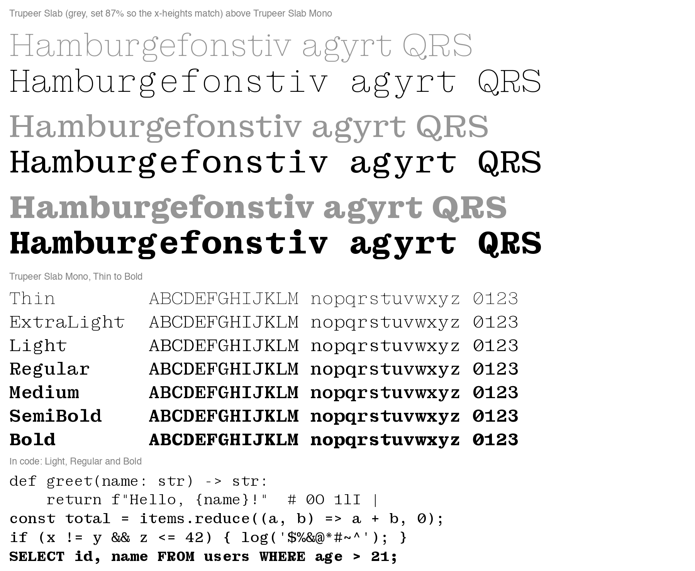

# AA Bridge Slab Mono

A monospaced companion to AA Bridge Slab. Every character takes the same 600-unit slot.

Seven weights, Thin to Bold, with the original's character set: 616 of its 618 characters (676 glyphs), covering the Latin languages AA Bridge Slab covers, Vietnamese included. The two left out are the fi and fl ligatures.

- `fonts/variable/AABridgeSlabMono[wght].ttf`: one file with every weight from 100 to 700
- `fonts/ttf` and `fonts/otf`: Thin, ExtraLight, Light, Regular, Medium, SemiBold and Bold



## How it is made

The glyphs are the original's own drawings (the 16pt optical size in `../sources/AABridgeSlab.glyphs`), not new ones. The family is built from three masters, and the weights between them are interpolated:

- **Thin** from the original's Thin.
- **Regular** from the original's Regular.
- **Bold** from a point 80% of the way from the original's Regular to its Bold (`BOLD_AT` in `tools.py`). The original's Bold is too heavy for the slot. Like Courier Prime Bold and IBM Plex Mono Bold, the mono's Bold is lighter than a proportional Bold.

In every weight:

- **Scale.** The original is set at 87% in the slot (`S` in `tools.py`). At that size its n fits the slot as drawn, which is how typewriter slab monospaces like Courier keep natural proportions: a smaller x-height, not narrower letters. Most lowercase, the figures and most punctuation are used unchanged, only centred.
- **Narrow letters** (i, l, j, r, f, t, I, J, 1) get longer slabs, bars and arms to fill the slot. Only the top serifs of j and J grow, so their hooks keep the original's drawing. These changes are written once for the Regular and made by the same amounts in every weight (`G.like_regular`).
- **Wide letters** (most capitals, m, w, &, @, %, and the Bold's widest lowercase) get narrower counters and serifs. Their stems keep their weight: x is moved towards a heavier drawing before narrowing (`G.condense`). m, w, M and W are kept slightly lighter so they don't read as dark blots.
- **M** keeps upright legs with the V's point raised, as in Courier and IBM Plex Mono. The fillets rounding its joints move with the V.
- **Rounded joints.** The original rounds the inside joints PP Kyoto rounds (K's crotch, the joints of M, V, W, X, Y and others) with fillets laid into each corner. Narrowing a letter moves its drawing towards a heavier one, and a fillet would drift off its corner, so after narrowing each fillet is laid back into its corner as the original lays it: the same legs along each edge and the same curve (`fillets.py`).
- **Angled cuts.** The original cuts the points of A, M, N, V, W, v and w at 30°, one corner on the overshoot line. Narrowing steepens a cut, so it is cut again at 30°: the corner on the overshoot stays and the other slides along its stroke edge (`G.recut`).
- **For code:** the original's slashed zero is the default 0, ' and " are straight wedges, / and \ run from below the baseline to above the capitals, and the underscore fills the slot.
- **Accented letters.** The source draws them as plain outlines, so `compose.py` matches each one against its base letter. The base is drawn as the base's own result (so í has the i's long slabs), and each accent goes back where it sat against the base's nearest anchor. Anchors are carried through every change, so accents stay centred on narrowed capitals.
- **Everything else beyond the basic set** (Æ, Œ, ŋ, ð, currency, symbols, small figures, fractions, dashes, the LJ and DŽ digraphs) is used as drawn, or narrowed to fit the slot when too wide. The ellipsis is rebuilt from three period dots, since the source's Regular ellipsis has uneven, overlapping dots.

Each change is a recipe in `recipes.py`. A glyph without a recipe is used as drawn.

## Monospace practice

- **No ligatures.** fi, fl, ff and the others are left out, with the `liga` feature, as joining two letters into one slot would break the grid.
- **Combining accents take no room** and sit over the character before them; the `mark` and `mkmk` features place them exactly, from the anchors.
- **Fractions, superiors and inferiors** take one slot per figure.
- **Plain zero.** The slashed zero is the default; Stylistic Set 2 gives the original's plain one (the original's `zero` switch would do nothing here).
- Kept from the original: `ccmp`, `locl` (Turkish i, Romanian comma accents, Catalan middle dot), `frac`, `numr`, `dnom`, `sups`, `subs`, `sinf`, `ordn`, `case`, and Stylistic Set 1 (the tilted o).

## Building

```bash
pip install -r requirements.txt
python build.py
```

This draws the three masters into `build/` (UFOs and a designspace), then writes the variable font and the seven static weights into `fonts/`.

## Licence

SIL Open Font License 1.1, as for AA Bridge Slab (see `../OFL.txt`).
